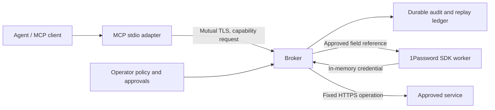

# 1Password Agent Broker

[](https://github.com/astrivant/1password-agent-broker/actions/workflows/ci.yml)

Let agents use credentials without handing them the keys. Approve a capability, let the broker perform the operation, and return the result to the agent. Credential access and authorization stay in a service you control.

**Contents**

<!-- TOC -->

- [Quick start](#quick-start)
  - [Install and try it](#install-and-try-it)
  - [Use with an AI agent](#use-with-an-ai-agent)
- [Why use this tool?](#why-use-this-tool)
- [How it works](#how-it-works)
  - [Request and credential flow](#request-and-credential-flow)
  - [Trust boundary](#trust-boundary)
- [Operate the broker](#operate-the-broker)
  - [Connect 1Password and an agent](#connect-1password-and-an-agent)
  - [Review access and recover work](#review-access-and-recover-work)
- [Input variables](#input-variables)
  - [Broker environment](#broker-environment)
  - [Command and file inputs](#command-and-file-inputs)
  - [Release automation](#release-automation)
- [Documentation](#documentation)
  - [Deployment and security](#deployment-and-security)
  - [Development and releases](#development-and-releases)
- [Kubernetes and monitoring](#kubernetes-and-monitoring)
- [Service client SDK](#service-client-sdk)

<!-- /TOC -->

## Quick start

### Install and try it

Requires Python 3.12 or newer, excluding 3.14.1. No 1Password account, model API key, or cloud infrastructure is needed for the demo.

```sh
python -m pip install 1password-agent-broker
agent-broker demo
```

The local demo reports two healthy operations, successful replay protection, cross-identity denial, and zero external provider calls. It creates temporary certificates and synthetic identities, then removes its temporary data on exit.

### Use with an AI agent

Point your agent at the local [SKILL.md](SKILL.md) or its [public URL](https://github.com/astrivant/1password-agent-broker/blob/main/SKILL.md) for supported setup, validation, and operating procedures. The skill explains package use without a source checkout and which development workflows require one. Once a broker is configured, the [MCP setup](docs/operations.md#mcp-configuration) connects an agent through the Model Context Protocol (MCP), using its workload certificate.

## Why use this tool?

- **Keep credentials out of agent responses.** The broker resolves an approved credential and uses it for a fixed operation.
- **Control each identity's access.** Workload certificates identify the caller; grants bind approval to a request, capability, policy revision, and expiry.
- **Retry without repeating completed work.** Recorded results survive a lost response. Uncertain outcomes remain visible instead of being silently resubmitted.
- **Attribute operations to reviewed work.** Operator policy binds identity, revision, run, and optional task IDs to workload certificates. Denials and replay outcomes retain a validated audit record.
- **Recover results after approval expires.** Inspect an existing request without renewing its grant or repeating its operation.
- **Connect through MCP.** An agent-facing stdio adapter delegates execution to the authenticated broker.

The first capability is an authenticated HTTPS health check. Provider and executor interfaces allow additional reviewed capabilities; agents cannot supply arbitrary secret references, URLs, headers, or HTTP methods.

## How it works

### Request and credential flow



The operator owns policy and approvals. The broker authenticates the workload, validates its request, and records execution state before accessing a credential. The agent receives a bounded result; authorization remains on the broker.

### Trust boundary

The broker and its host can access the credentials they use. Protect that host and the workload certificate keys. This alpha has synthetic integration evidence; live account permissions and deployment isolation require operator validation. See [security](SECURITY.md), [architecture](docs/architecture.md), and [validation boundaries](docs/validation.md).

For a wholly local developer environment, consider [1Password's native Environments MCP server](https://www.1password.dev/environments/mcp-server). This broker is for credential-backed operations executed by a separately authenticated service.

## Operate the broker

### Connect 1Password and an agent

The broker includes the [official 1Password Python SDK](https://github.com/1Password/onepassword-sdk-python). Create a narrowly scoped service account and follow [operator setup](docs/operations.md). It covers platform requirements, policy, certificates, the broker process, request approvals, and MCP configuration.

### Review access and recover work

Use the [operations guide](docs/operations.md) for revocation, credential rotation, cancellation, and uncertain outcomes. Keep grant management on the operator side and inspect the durable ledger before retrying work whose result is unknown.

## Input variables

`agent-broker demo` needs no configuration or credentials. For a deployed broker, the operator supplies the inputs below. Environment variables belong to the broker process; the CLI does not automatically load a `.env` file.

### Broker environment

| Variable | Purpose | When required and where to configure it |
| --- | --- | --- |
| `OP_SERVICE_ACCOUNT_TOKEN` | 1Password service-account token used by the official SDK. | Required for real credential resolution. Inject through the broker's runtime secret facility. Policy `bootstrap_env` can select another broker-held variable; this is the default name. |
| `PGHOST`, `PGPORT` | PostgreSQL server address and port. | Configure for `serve --storage postgresql`; otherwise unused. Unset connection parameters use libpq defaults. |
| `PGDATABASE`, `PGUSER` | PostgreSQL database and login role. | Configure for PostgreSQL storage, using the broker's database and role. Unset parameters use libpq defaults. |
| `PGPASSWORD` or `PGPASSFILE` | Database password or path to a private libpq password file. | Required when PostgreSQL authentication needs a password. Use a runtime secret or mounted password file. The Helm chart supplies `PGPASSWORD`. |
| `PGSSLMODE` | PostgreSQL TLS verification mode. | Optional for PostgreSQL; the broker defaults to `verify-full`. The Helm chart enforces that value. |
| `PGSSLROOTCERT` | Path to the CA certificate used to trust PostgreSQL. | Set when the database CA is outside libpq's default trust-file location. The chart mounts its `ca.crt` Secret key at `/etc/broker/postgresql/ca.crt`. |

SQLite is the default storage backend and needs none of the `PG*` variables. PostgreSQL uses [libpq connection variables](https://www.postgresql.org/docs/current/libpq-envars.html); broker-owned connection, pool, and statement limits are described in [operations](docs/operations.md#kubernetes-and-high-availability). For Kubernetes, provide existing Secret names through [chart values](helm/1password-agent-broker/README.md) and start with a [configuration reference](helm/1password-agent-broker/references/README.md). Keep provider tokens, database passwords, and operator policy/grant files out of MCP configuration and agent context.

### Command and file inputs

Pass these options to the named command. Paths refer to files provisioned on that command's host; JSON formats and complete commands are in [operator setup](docs/operations.md#operator-setup) and [MCP configuration](docs/operations.md#mcp-configuration).

| Command input | Purpose | Requirement or default |
| --- | --- | --- |
| `serve`, `approve`, `config lint`: `--policy PATH`, `--approvals PATH` | Operator-owned JSON policy and exact-request grants. Policy binds workload certificates to identities, credential references, and fixed capabilities. | Both required. An initial approvals file contains `{}`. |
| `serve`: `--storage`, `--database PATH` | Durable replay/audit storage backend and SQLite file. | Storage defaults to `sqlite`, which requires `--database`. For `postgresql`, omit `--database` and supply the `PG*` inputs above. |
| `serve`: `--cert PATH`, `--key PATH`, `--client-ca PATH` | Broker server certificate, private key, and CA that authenticates workload certificates. | All required; protect the private key. |
| `serve`: `--destination-ca PATH` | CA bundle for the capability's destination service. | Optional; system trust roots are used when omitted. |
| `serve`: `--host`, `--port` | Broker HTTPS listener. | Defaults: `127.0.0.1`, `8443`. |
| `serve`: `--metrics-host`, `--metrics-port` | Private metrics and status listener. | Defaults: `127.0.0.1`, `9090`. Keep this listener on a trusted network. |
| `serve`: `--capacity` | Maximum concurrent capability handlers. | Default `8`; supported range `1` to `64`. |
| `mcp`: `--url`, `--ca PATH`, `--cert PATH`, `--key PATH` | Broker URL, trusted broker CA, and the workload's client certificate/private key. | All required. The MCP adapter receives its workload identity, never the provider token. |
| `approve`: `--principal`, `--operation`, `--ttl` | Policy workload, named capability, and grant lifetime in seconds. | Principal and operation required; TTL defaults to `300`. See [approve and invoke](docs/operations.md#approve-and-invoke) for request identifiers and grant limits. |

For developers, `BROKER_TEST_POSTGRES=1` opts into integration tests against an explicitly selected disposable PostgreSQL database. It is not a runtime setting; see [development checks](docs/development.md#chart-validation).

### Release automation

These inputs are for package maintainers, not broker deployments. The workflow uses GitHub Actions secrets for credentials; never commit their values.

| Input | Purpose | Where it comes from |
| --- | --- | --- |
| `COSIGN_PRIVATE_KEY` | Full PEM signing-key contents, not a filesystem path. | Required Actions secret for signed releases; provision with the [release-signing helper](docs/development.md#release-signing). |
| `COSIGN_PASSWORD` | Passphrase for the signing key. | Actions secret required for an encrypted key; defaults to empty for an unencrypted key. |
| `PYPI_API_TOKEN` | Publishes the verified Python archives to PyPI. | Existing organization Actions secret, with this repository granted access. Only the `pypi` publication job consumes it. See [PyPI publication](docs/development.md#pypi-publication). |
| `GH_TOKEN` | Authenticates release operations performed with `gh`. | CI supplies GitHub's built-in token; a separate personal token is not needed. Local commands use your authenticated `gh` session. |
| `EXPECTED_RELEASE_KEY_FINGERPRINT` | Independently trusted SHA-256 fingerprint of the release signing public key. | Non-secret value pinned in the workflow and required by the verification script. See [release verification](docs/development.md#release-signing) before trusting a downloaded key. |
| `GITHUB_REPOSITORY`, `GITHUB_REF_NAME`, `GITHUB_SHA` | Repository, tag/ref, and source revision used for release provenance. | GitHub supplies these in Actions. When running `scripts/release/verify.sh` locally, supply the expected repository, release tag, and exact source commit. |
| `pypi_release` | Optional workflow-dispatch input for retrying publication of an existing signed tag such as `v0.1.1`. | Defaults to empty; set when dispatching `ci.yml` from `main` using the documented PyPI retry command. |

## Documentation

### Deployment and security

- [Operations and CLI](docs/operations.md): configure and run the broker.
- [Architecture](docs/architecture.md): ownership, interfaces, and data flow.
- [Security policy](SECURITY.md): handling credentials and reporting vulnerabilities.
- [Validation](docs/validation.md): covered contracts and remaining integration work.

### Development and releases

- [Development](docs/development.md): local checks, containers, and pinned tools.
- [Signed releases](docs/development.md#release-signing): key setup, publishing, and artifact verification.
- [Contributing](CONTRIBUTING.md) and [agent instructions](SKILL.md) ([public URL](https://github.com/astrivant/1password-agent-broker/blob/main/SKILL.md)).
- [Current RFC review](docs/rfc-review.md): implemented gaps, evidence, and remaining integration gates for [RFC #55](https://github.com/astrivant/product-research/pull/55).

This is an independent Astrivant project using 1Password's official SDK. It is not an official 1Password product.

## Kubernetes and monitoring

The [Helm chart](helm/1password-agent-broker/README.md) supports two broker replicas with a shared PostgreSQL replay ledger, validated ConfigMaps, and private Flask metrics/status endpoints. See [operations](docs/operations.md#kubernetes-and-high-availability) for database durability, image/Secret prerequisites, CRD design, and sizing guidance.

## Service client SDK

Applications calling a separately deployed broker can install the
[standalone SDK](pkg/python/broker_sdk/README.md). It provides the typed mTLS key-service
client and shared wire contracts without installing the server or 1Password SDK.
The broker retains key custody and evaluates current authorization for each call.
