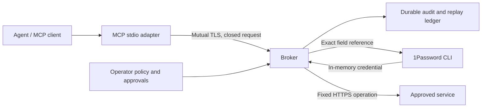

# 1Password Agent Broker

Let agents use credentials without handing them the keys. An operator approves a named capability, the broker authenticates the workload and performs the operation, and the agent receives a bounded result. Every attempt has a durable, secret-free audit trail.

[](https://github.com/astrivant/1password-agent-broker/actions/workflows/ci.yml)

<!-- toc -->

- [Try it](#try-it)
- [What you get](#what-you-get)
- [Connect a real service](#connect-a-real-service)
- [Architecture and trust](#architecture-and-trust)
- [Project documentation](#project-documentation)

<!-- /toc -->

## Try it

Requires Python 3.12 or newer, excluding 3.14.1, and Git. The demo requires no 1Password account, model API key, or cloud infrastructure.

```sh
python -m pip install 'git+https://github.com/astrivant/1password-agent-broker.git'
agent-broker demo
```

The bounded demo creates two synthetic identities, a local HTTPS target, and a mutually authenticated broker. It reports two healthy operations, successful replay protection, cross-identity denial, and zero external provider calls. Temporary certificates and data are removed on exit.

## What you get

- **Keep credentials behind the broker.** Model requests cannot select arbitrary vaults, fields, URLs, HTTP methods, or headers.
- **Separate identities.** Workload certificates bind each operation to a reviewed identity revision and run.
- **Approve precisely.** Grants authorize one request, capability, principal, policy revision, and expiration time.
- **Recover safely.** Lost-response retries return a recorded result. An uncertain outcome stays uncertain, so a retry cannot silently repeat an operation.
- **Integrate through MCP.** The MCP 2 stdio adapter works as an agent-facing client. Authorization remains on the broker.

The first capability is an authenticated HTTPS health check. The provider and executor interfaces support adding reviewed capabilities; this version does not expose an arbitrary HTTP or secret-reading tool.

## Connect a real service

Install the [official 1Password CLI](https://www.1password.dev/cli/get-started), create a narrowly scoped service account, and follow [operator setup](docs/operations.md). That guide includes the policy, certificate setup, approvals, MCP configuration, credential rotation, and cancellation.

For an entirely local developer environment, consider [1Password's native Environments MCP server](https://www.1password.dev/environments/mcp-server) first. This broker addresses a different boundary: credential-backed operations executed in a trusted service, without returning those credentials to the agent.

## Architecture and trust



The broker and its host can access the credentials they use. Workload certificate keys grant capability access and must be protected. This is an alpha implementation with synthetic integration evidence, not a claim of isolation from a compromised host. Read [SECURITY.md](SECURITY.md) and [the architecture](docs/architecture.md) before introducing live credentials.

## Project documentation

- [Operations and CLI](docs/operations.md)
- [Validation and limitations](docs/validation.md)
- [Development, containers, and pinned tools](docs/development.md)
- [Contributing](CONTRIBUTING.md) and [agent instructions](SKILL.md)
- [Origin: RFC #8](https://github.com/astrivant/product-research/pull/8)

This is an independent Astrivant project using 1Password's supported CLI. It is not an official 1Password product.
