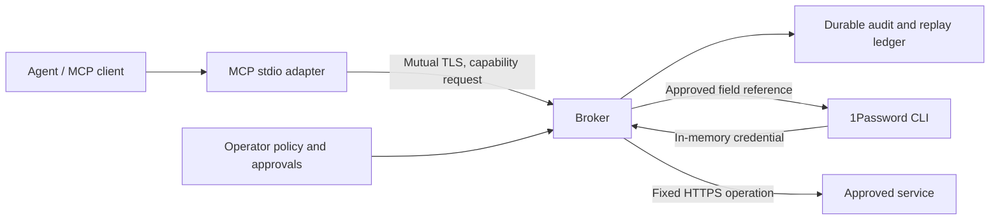

# 1Password Agent Broker

Let agents use credentials without handing them the keys. Approve a capability, let the broker perform the operation, and return the result to the agent. Credential access and authorization stay in a service you control.

[](https://github.com/astrivant/1password-agent-broker/actions/workflows/ci.yml)

**Contents**

<!-- toc -->

- [Quick start](#quick-start)
  - [Install and try it](#install-and-try-it)
  - [Use with an AI agent](#use-with-an-ai-agent)
- [Why use this tool?](#why-use-this-tool)
- [How it works](#how-it-works)
  - [Request and credential flow](#request-and-credential-flow)
  - [Trust boundary](#trust-boundary)
- [Operate the broker](#operate-the-broker)
  - [Connect 1Password and an agent](#connect-1password-and-an-agent)
  - [Review access and recover work](#review-access-and-recover-work)
- [Documentation](#documentation)
  - [Deployment and security](#deployment-and-security)
  - [Development and releases](#development-and-releases)

<!-- /toc -->

## Quick start

### Install and try it

Requires Python 3.12 or newer, excluding 3.14.1, and Git. No 1Password account, model API key, or cloud infrastructure is needed for the demo.

```sh
python -m pip install 'git+https://github.com/astrivant/1password-agent-broker.git'
agent-broker demo
```

The local demo reports two healthy operations, successful replay protection, cross-identity denial, and zero external provider calls. It creates temporary certificates and synthetic identities, then removes its temporary data on exit.

### Use with an AI agent

Point your agent at [SKILL.md](SKILL.md) for the supported setup, validation, and operating procedures. Once a broker is configured, the [MCP setup](docs/operations.md#mcp-configuration) connects an agent through the Model Context Protocol (MCP), using its workload certificate.

## Why use this tool?

- **Keep credentials out of agent responses.** The broker resolves an approved credential and uses it for a fixed operation.
- **Control each identity's access.** Workload certificates identify the caller; grants bind approval to a request, capability, policy revision, and expiry.
- **Retry without repeating completed work.** Recorded results survive a lost response. Uncertain outcomes remain visible instead of being silently resubmitted.
- **Keep an operational record.** Dispatched requests have a durable audit and replay ledger, without storing credential values.
- **Connect through MCP.** An agent-facing stdio adapter delegates execution to the authenticated broker.

The first capability is an authenticated HTTPS health check. Provider and executor interfaces allow additional reviewed capabilities; agents cannot supply arbitrary secret references, URLs, headers, or HTTP methods.

## How it works

### Request and credential flow



The operator owns policy and approvals. The broker authenticates the workload, validates its request, and records execution state before accessing a credential. The agent receives a bounded result; authorization remains on the broker.

### Trust boundary

The broker and its host can access the credentials they use. Protect that host and the workload certificate keys. This alpha has synthetic integration evidence; live account permissions and deployment isolation require operator validation. See [security](SECURITY.md), [architecture](docs/architecture.md), and [validation boundaries](docs/validation.md).

For a wholly local developer environment, consider [1Password's native Environments MCP server](https://www.1password.dev/environments/mcp-server). This broker is for credential-backed operations executed by a separately authenticated service.

## Operate the broker

### Connect 1Password and an agent

Install the [official 1Password CLI](https://www.1password.dev/cli/get-started), create a narrowly scoped service account, and follow [operator setup](docs/operations.md). It covers policy, certificates, the broker process, request approvals, and MCP configuration.

### Review access and recover work

Use the [operations guide](docs/operations.md) for revocation, credential rotation, cancellation, and uncertain outcomes. Keep grant management on the operator side and inspect the durable ledger before retrying work whose result is unknown.

## Documentation

### Deployment and security

- [Operations and CLI](docs/operations.md): configure and run the broker.
- [Architecture](docs/architecture.md): ownership, interfaces, and data flow.
- [Security policy](SECURITY.md): handling credentials and reporting vulnerabilities.
- [Validation](docs/validation.md): covered contracts and remaining integration work.

### Development and releases

- [Development](docs/development.md): local checks, containers, and pinned tools.
- [Signed releases](docs/development.md#release-signing): key setup, publishing, and artifact verification.
- [Contributing](CONTRIBUTING.md) and [agent instructions](SKILL.md).
- [Design proposal: RFC #8](https://github.com/astrivant/product-research/pull/8).

This is an independent Astrivant project using 1Password's supported CLI. It is not an official 1Password product.
